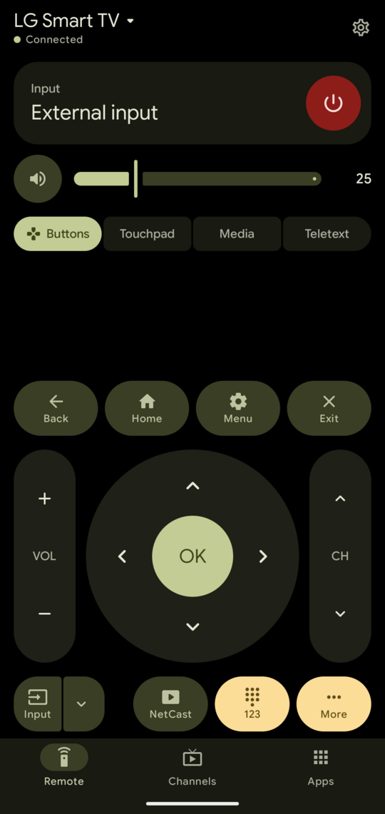
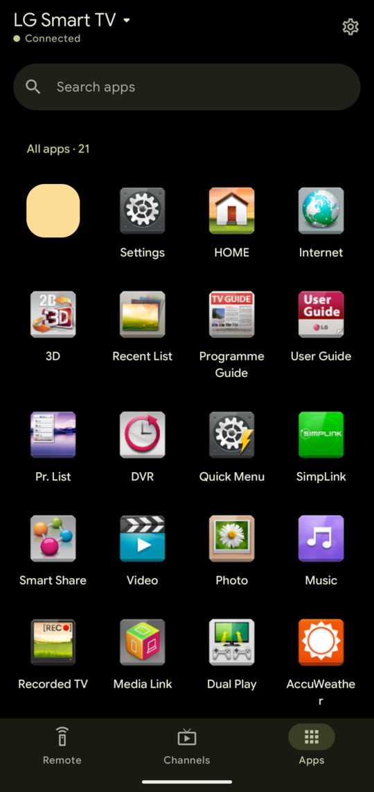
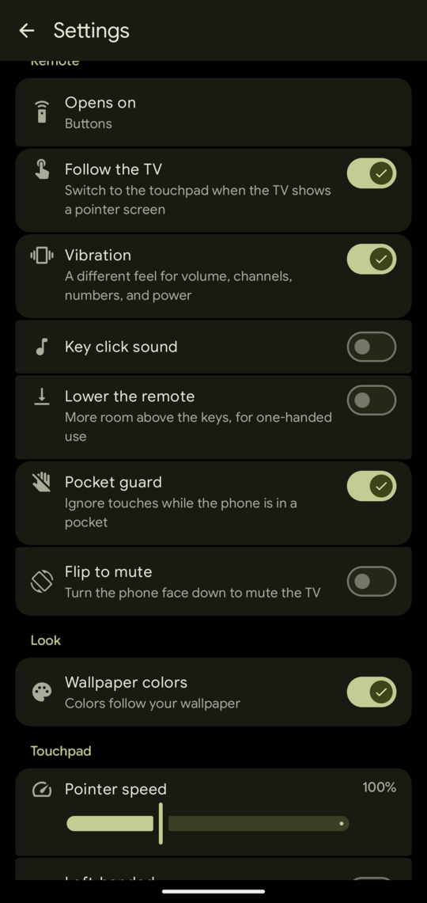
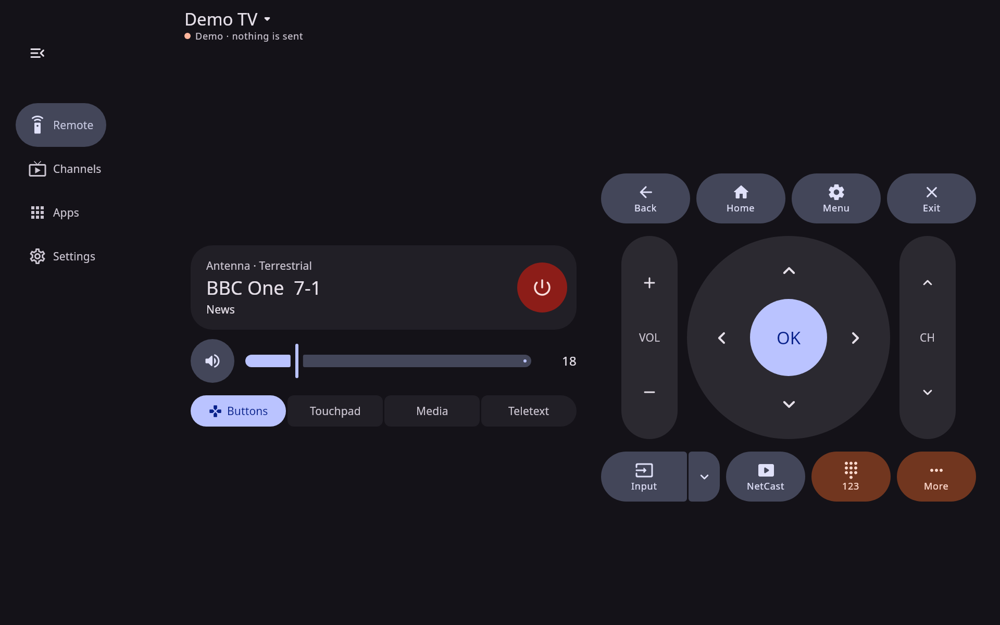
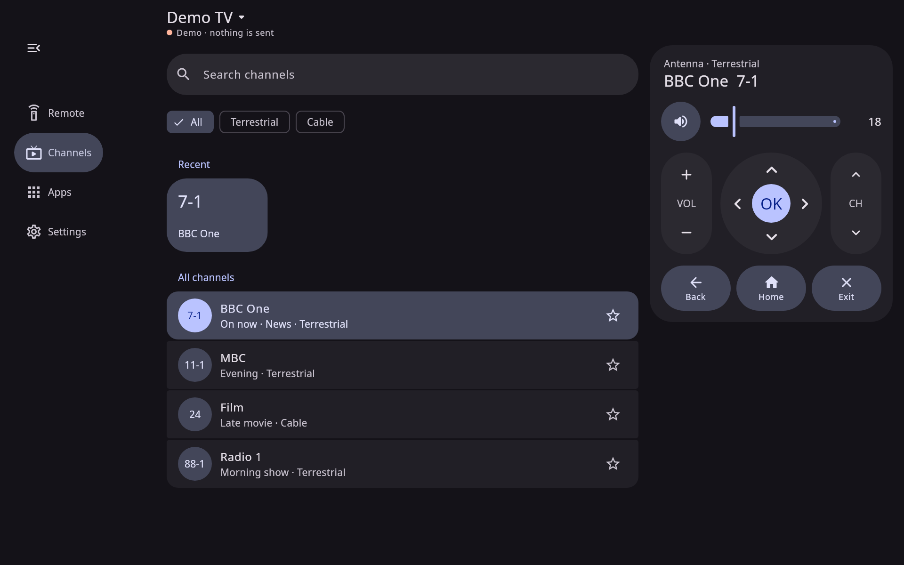
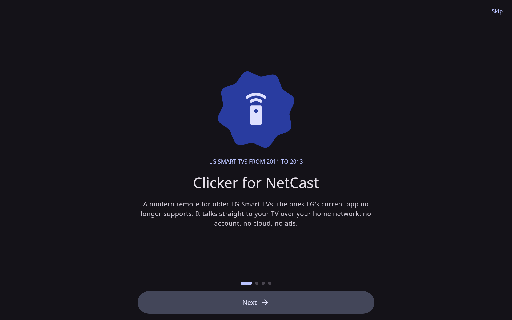

# Clicker for NetCast

**The modern remote for LG NetCast smart TVs (2011–2013).** For Android phones and tablets, and for Windows, macOS, and Linux.

<p align="center">
  
  &nbsp;
  
  &nbsp;
  
</p>

<p align="center">
  
</p>

LG Smart TVs from 2011, 2012, and 2013 run LG's **NetCast** platform. LG's current app, LG ThinQ, only supports the webOS TVs that came after them. Clicker gives the NetCast sets a modern remote again, built with Material 3 Expressive.

It talks straight to your TV over your home network. There's no account, no cloud, and no ads.

## Does it work with my TV?

Find the model number on the sticker on the back of the TV, such as `47LM6200`. The letters after the screen size are the series.

| Your TV | Platform | Works? |
|---|---|---|
| 2012: LM, LS, PM series and similar | NetCast 3.0 (UDAP 2.0) | **Yes.** Tested on a 47LM6200. |
| 2013: LA, LN, PN series and similar | NetCast 4.0 (UDAP 2.0) | **Yes**, by the same protocol. Not tested on a real 2013 set yet. |
| 2011: LW, LV series and similar | NetCast 2.0 (ROAP) | **Should work.** The older protocol is implemented but untested. |
| 2014 and later | webOS | **No.** Use LG ThinQ. |

If you have a 2011 or 2013 set, please [open an issue](https://github.com/JosephDoesLinux/lg-netcast-remote/issues) and say whether it worked.

## What it does

- **Every key on the original remote**: D-pad, numbers, color keys, media keys, teletext, 3D, and the rest.
- **A touchpad** for the Magic Remote pointer, with two-finger scrolling.
- **Typing**: when the TV asks for text, your keyboard opens. On desktop you can paste.
- **Channels and apps**: search, favorite, and rename channels, and open the TV's apps by their own icons.
- **Finds and pairs** with the TV on your network, using the code the TV shows.
- **Reconnects by itself**: when the TV is off, Clicker waits and connects as soon as you turn it on.
- **Macros**, a kids mode with a volume ceiling and a PIN for adult apps, a sleep timer, an XMLTV programme guide, a screen preview, and a demo TV to try it without one.

**On Android** (13 and later, built for Android 17):

- Your volume buttons change the TV's volume, with Android's own volume slider.
- Home-screen widgets, a Quick Settings tile, shortcuts, lock-screen controls, and picture-in-picture.
- Wallpaper colors, true black in dark mode, and layouts for phones, tablets, and foldables, including tabletop mode.

**On desktop**:

- Your keyboard is the remote: arrow keys and Enter steer, Esc goes back, `+` and `-` change the volume, Page Up and Page Down change channel, `M` mutes, and the number keys type a channel.
- A navigation rail, the remote beside your channels, and light or dark themes.

<p align="center">
  
  
</p>

## What it can't do

Some things these TVs simply don't allow over the network. Clicker says so rather than pretending.

- **Turn the TV on.** NetCast sets drop off the network in standby, and LG's protocol has no power-on command. LG's own [Connect SDK](https://connectsdk.com/en/latest/apis-and/and-netcasttvservice.html) and [Home Assistant](https://www.home-assistant.io/triggers/lg_netcast.turn_on/) reach the same conclusion. Turn it on with the TV's remote and Clicker connects by itself. Wake-on-LAN is in Settings as an experiment; if it wakes your set, please tell us.
- **Switch straight to a particular input.** There's no command for it, only the Input key. Clicker's input shortcuts are macros you record once.
- **Show what's playing in an app or on HDMI.** The TV only reports broadcast channels.
- **Install new TV apps.** LG's NetCast app store closed years ago, and some apps on the TV may no longer open.

## Download

There are no releases yet. Build it from source as described below.

## Build from source

You need **JDK 21**. For the Android app you also need the **Android SDK with platform 37** (Android 17). Without an Android SDK, the build includes only the desktop app.

```sh
# Android: a debug APK in app/build/outputs/apk/debug/
./gradlew :app:assembleDebug

# Desktop: run it
./gradlew :desktop:run

# Desktop: a package for the OS you're on
./gradlew :desktop:packageDeb          # or packageRpm, packageAppImage, packageDmg, packageMsi

# Protocol tests
./gradlew :protocol:test

# Re-render the desktop screenshots in this README, offscreen, with the demo TV
./gradlew :desktop:screenshots
```

## How it works

Clicker speaks **UDAP 2.0**, the protocol LG published for second-screen apps in its [NetCast developer documents](https://webostv.developer.lge.com/assets/netcast/NetCast-UDAP.pdf). For 2011 sets it speaks the older **ROAP**.

1. **Discovery.** An SSDP `M-SEARCH` for `udap:rootservice` on the local network. If the router drops multicast, Clicker falls back to UDAP's broadcast `B-SEARCH` on port 1990.
2. **Pairing.** Clicker asks the TV to show a six-digit code, then sends it back. The TV remembers the pairing.
3. **Control.** Keys, the pointer, text, and app launches are small XML messages sent over HTTP to the TV's port 8080. Volume, the current channel, the channel list, apps and their icons, and a screen grab are queries on the same port.
4. **Events.** The TV reports channel changes, the on-screen keyboard, and pointer mode by sending HTTP requests back to a small server inside the app.

Everything stays between your device and your TV.

### Project layout

| Module | What's in it |
|---|---|
| `protocol/` | UDAP and ROAP: messages, parsers, SSDP, the TV link, key codes, Wake-on-LAN. Plain Kotlin, with tests. |
| `core/` | The TV session (pairing, keys, volume, channels, apps, macros, reconnecting) and the app's models. Plain Kotlin/JVM, shared by Android and desktop through a small `Platform` interface. |
| `app/` | The Android app: Jetpack Compose with Material 3 Expressive, widgets, the Quick Settings tile, media session, and Android 17 integration. |
| `desktop/` | The Windows, macOS, and Linux app: Compose Multiplatform. |
| `wear/` | A Wear OS companion tile. |
| `benchmark/` | Performance tests for the Android app. |
| `sidecar/` | A small TV-side web page for experimenting with UDAP's App-to-App service. |

The Android and desktop screens share their design and most of their code, but for now the desktop copy is separate. That's because the Android app uses Material 3 1.5 beta APIs that Compose Multiplatform hasn't caught up with yet. Merging them into one shared UI module is planned.

## Made with AI

This project is open about how it was made. **All of its code was written by AI coding agents, mostly Anthropic's Claude (in Claude Code), with an early start in Cursor.** [JosephDoesLinux](https://github.com/JosephDoesLinux) directed the work and tested it on a real 2012 LG 47LM6200.

That means it has had less human code review than a typical project. Read the code before you trust it with anything important, and please [report anything odd](https://github.com/JosephDoesLinux/lg-netcast-remote/issues).

## Privacy

Clicker has no account, no analytics, and no servers. It only talks to TVs on your local network. Pairing keys, settings, and favorites are stored on your device. Screen-preview stills stay on your device and are never uploaded.

## Contributing

Issues and pull requests are welcome. Especially useful:

- Reports from **2011 (ROAP) and 2013 sets**: what worked and what didn't. The Diagnostics screen has a log you can copy.
- Translations. The text isn't in resource files yet, so moving it there is a good first contribution.
- Bringing the desktop and Android UIs together into one Compose Multiplatform module.

## Not affiliated with LG

LG, NetCast, webOS, and Magic Remote are trademarks of LG Electronics. Clicker for NetCast is an independent open-source project. It isn't affiliated with or endorsed by LG.

## License

[MIT](LICENSE).
